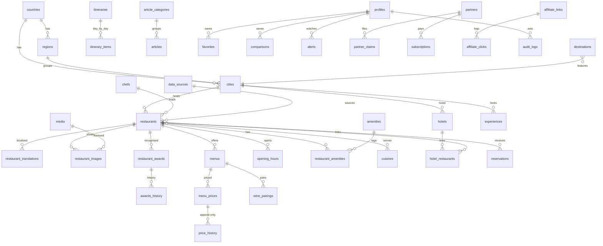

# Atlas Table Guide — Implementation Plan

> Brand values are placeholders and live only in `src/config/brand.ts`.
> This project is a fully independent guide. It does not use, imitate or reference the marks,
> names, symbols, copy or data of any third-party restaurant guide or award body.

## 1. Architecture

| Layer | Choice | Notes |
|---|---|---|
| Framework | Next.js 15 App Router, React 19, TypeScript strict | Locale-prefixed routes (`/en`, `/it`), SSG + ISR (`revalidate`) for content, SSR for faceted hubs |
| Styling | Tailwind CSS v4 with CSS-variable tokens (`src/app/globals.css`) | Red Editorial palette, self-hosted Inter + Playfair Display |
| Data access | `src/db/repository.ts` — one `Dataset` interface, two loaders | `demo` loader (bundled TypeScript seed, `is_demo=true`) and `supabase` loader (Postgres via Supabase REST). Same filter/sort/search code runs on both |
| Database | PostgreSQL 15+/Supabase + PostGIS | `supabase/migrations/*.sql`, RLS on every table, append-only `price_history`, materialised view for the Price Index |
| Search | In-process index (`src/lib/search.ts`): prefix + trigram typo tolerance + synonyms + facets | Typesense adapter interface documented; Postgres FTS + `pg_trgm` indexes in migration |
| Maps | MapLibre GL, style URL configurable (default OpenFreeMap, no key) | Clusters, hover sync, "Search this area", list alternative always rendered |
| Images | Procedurally art-directed SVG scenes rasterised to WebP by `scripts/generate-images.mjs` | Flagged "REPLACE BEFORE LAUNCH"; `buildAlt()` for every image; "Illustrative image" label |
| i18n | Own dictionary layer (`src/i18n`) | EN full, IT full UI + metadata; content falls back to EN with `lang="en"` and "translation pending" note |
| Payments / email / LLM / FX | Stripe test, Resend, OpenAI-compatible, Frankfurter (ECB) | All server-side, all optional, honest "not configured" UI when missing |
| Tests | Vitest (unit), Playwright + axe (e2e/a11y/visual), `scripts/seo-check.mjs`, `scripts/banned-terms.mjs`, `scripts/secret-scan.mjs`, SQL RLS tests (`supabase/tests`) | |

## 2. Folder tree

```
atlas-table-guide/
  docs/ PLAN.md REPORT.md SEO.md DATA.md BRAND.md reference/
  public/ images/generated/*.webp favicon.svg apple-touch-icon.png og-default.png
  scripts/ generate-images.mjs seo-check.mjs banned-terms.mjs secret-scan.mjs generate-seed-sql.ts db-test.sh dev-setup.sh
  supabase/ migrations/ seed.sql tests/
  src/
    app/ [locale]/… admin/… go/[id] api/… robots.ts sitemap*.ts llms.txt
    components/ ui/ layout/ media/ cards/
    features/ home/ directory/ restaurant/ compare/ favourites/ search/ consent/ forms/ map/
    config/ brand.ts site.ts
    data/ demo/ generated/
    db/ types.ts repository.ts supabase.ts writes.ts
    i18n/ en.ts it.ts index.ts
    lib/ slug.ts price.ts filters.ts search.ts alt.ts compare-url.ts csv-import.ts geo.ts fx.ts format.ts rbac.ts contrast.ts
    seo/ jsonld.ts metadata.ts indexable-facets.ts
  tests/ unit/*.test.ts e2e/*.spec.ts
```

## 3. Route map

| Route | Render | Indexable |
|---|---|---|
| `/{l}/` | SSG + ISR | yes |
| `/{l}/restaurants/` (+ `/{country}/`, `/{country}/{region-or-city}/`) | SSR (search params) | yes without params, gated by quality gate; any param → `noindex,follow` + canonical to parent |
| `/{l}/restaurant/{slug}/` | SSG + ISR | yes (published) |
| `/{l}/destinations/` | SSG | yes |
| `/{l}/chefs/{slug}/` | SSG | yes |
| `/{l}/collections/` `/{slug}/` | SSG | yes when ≥ N results |
| `/{l}/hotels/` `/hotel/{slug}/` | SSG | yes |
| `/{l}/experiences/` `/experience/{slug}/` | SSG | yes |
| `/{l}/travel/` `/travel/{slug}/` | SSG | yes |
| `/{l}/price-index/` | SSG + ISR | yes |
| `/{l}/magazine/` `/{category}/` `/{slug}/` | SSG | yes |
| `/{l}/gifts/` `/club/` `/concierge/` | SSG/SSR | yes / yes / yes |
| `/{l}/compare/?r=` | SSR | no |
| `/{l}/account/*` | client | no |
| `/{l}/business/` `/{topic}/` | SSG | yes |
| `/{l}/about` `/editorial-policy` `/methodology` `/contact` `/legal/{doc}` | SSG | yes |
| `/{l}/design-system` | SSG | no |
| `/admin/*` | SSR, role-gated | no (also robots-disallowed) |
| `/go/{id}` | route handler 302 + click log | no (robots-disallowed) |
| `/robots.txt` `/sitemap.xml` `/sitemaps/{segment}.xml` `/llms.txt` `/llms-full.txt` | route handlers | — |

## 4. Database ERD



## 5. Component inventory

Layout: `Header` (sticky Carmine bar, nav row, mega-menus, prefs popover, favourites badge, account, Join the Club, drawer), `Footer` (Garnet, columns, newsletter mini-form, disclaimer), `SkipLink`, `Breadcrumbs`, `DemoRibbon`, `CookieConsent`.
UI: `Button`, `LinkButton`, `Chip`, `Tabs`, `Badge/StatusPill`, `Field/Input/Select/Checkbox`, `Toast`, `EmptyState`, `ErrorState`, `Skeleton`, `Logo`, `SelectionMark`, `Section`, `Eyebrow`.
Media: `SmartImage` (next/image + blur + illustrative label), `Gallery` + `Lightbox`.
Cards: `DestinationCard`, `RestaurantCard` (save/compare), `ExperienceCard`, `HotelCard`, `ArticleCard`, `ItineraryCard`.
Features: `HeroSearch` (expanding advanced panel), `GlobalSearch` (command palette, `/`), `FilterSidebar` + `FilterSheet`, `SortSelect`, `ViewToggle`, `RestaurantMap`, `Pagination`, `PriceDashboard` + `Sparkline`, `Price` (client FX), `CompareTray`, `CompareTable`, `FavouriteButton`, `NewsletterForm`, `ContactForm`, `ReportForm`, `WaitlistForm`, `ConciergePlanner`, `CsvImporter`.

## 6. Requirement checklist

Legend: [x] done · [~] done with documented fallback/stub · [ ] not done (see REPORT.md)

### Guardrails & brand
- [x] §1 No third-party guide names/marks/assets/copy; banned-terms CI script
- [x] §1 Independence disclaimer on every page (footer)
- [x] §1 Atlas Selection with original compass/fork mark
- [x] §1 Demo venues carry only "Demo distinction · Level N"
- [x] §2 `brand.ts` single source of truth (header, footer, metadata, JSON-LD, logo text, llms.txt, emails)
- [x] §2 Logo component (light/dark/mark), favicon.svg, apple-touch-icon, og-default
### Design system
- [x] §3 Tokens as CSS variables + Tailwind theme; contrast unit test on all token pairs
- [x] §3 Fonts self-hosted (Inter, Playfair Display)
- [x] §3 Buttons/cards/focus ring/sticky header/reduced motion
- [x] §3 `/design-system` page (noindex)
- [x] §3B Header/Hero/Destinations/Experiences/Travel layouts
- [~] §3B Visual-regression baselines (390/768/1280) committed — reference screenshots were not attached; see REPORT
### Images
- [~] §4 Procedural art-directed images rasterised to WebP (REPLACE BEFORE LAUNCH), blur placeholders, responsive via next/image
- [x] §4 `buildAlt()`; CI fails on `` without alt; "Illustrative image" label
### IA & pages
- [x] §5 All routes in route map, custom 404 / 500 / maintenance
- [x] §6 Header + mega-menus + drawer + command-palette search (`/`) + footer
- [x] §7 Homepage 12 sections in order
- [x] §8 Directory: grid + map, all filters, all sorts, chips, count, clear, pagination, empty/error/loading
- [x] §8 Facet indexation whitelist (`src/seo/indexable-facets.ts`) + tests
- [x] §8 Hub SEO: one H1 template, ItemList + BreadcrumbList, intro, FAQ
- [x] §9 Restaurant profile: gallery + lightbox, price dashboard + sparkline, at-a-glance, chef, map, nearby, similar, FAQ, report form, sticky CTA, honest reservation state
- [x] §9 `buildRestaurantJsonLd()` with nested geo, opening hours, menu, amenities, allow-list
- [x] §10 Comparison (≤4, tray, localStorage, share URL, best values, sticky col, mobile cards)
- [x] §11 Country/region/city pages + quality gate; collections
- [x] §12 Hotels, experiences, affiliate `/go/{id}` with click log, travel itineraries (PDF via print + ICS export), magazine, club, gifts (honest test-mode state), concierge (rule-based fallback; LLM tool-calling when key present)
- [~] §13 Account (local favourites/compare; Supabase Auth when configured), business landing + topic pages + forms, admin (dashboard KPIs, restaurants, prices, CSV import dry-run + duplicate detection, audit log)
- [x] §14 Migrations (all tables, RLS, PostGIS, FTS/trigram, MV) + seed generator
- [x] §15 robots (AI crawler policy switch), llms.txt, sitemaps (index + segments, lastmod), hreflang, canonical, OG images, WebSite SearchAction, answer-first blocks
- [x] §16 EN + IT; currencies with FX provider + honest fallback; metric/imperial toggle
- [x] §18 Security headers, zod validation, rate limiting, consent-gated analytics
- [x] §19 Legal templates
- [x] §20 Global search suggestions, recent searches, keyboard nav; favourites logged-out
- [x] §21 Demo seed counts, ribbons, `ALLOW_DEMO_DATA=false`
### Tests
- [x] Unit: filters/sort, price/currency, slug, JSON-LD, compare URL, RBAC guards, CSV import + duplicates, facets, contrast, search
- [x] E2E + axe + visual snapshots
- [x] `seo:check`, `check:banned`, `check:secrets`
- [x] SQL RLS tests — 22 assertions pass on PostgreSQL 16 + PostGIS (`npm run db:test`)
